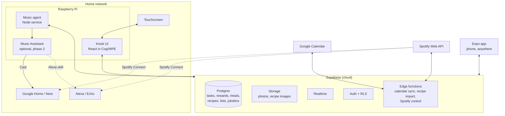

# Smart Home Hub — Design Document

**Owner:** Daniel Chung
**Status:** Draft / pre-build
**Last updated:** November 7, 2026

---

## 1. Overview

A wall- or counter-mounted touchscreen hub that runs the household day to day. It has calendars, chores with rewards, meal planning, shared lists, a photo frame, and a jukebox that plays music on the Alexa and Google Home speakers around the house.

A companion **Expo mobile app** reads and controls the same data from anywhere, and changes show up live on both the hub and phones.

### Goals
- Touch-first UI that's readable from across the room and usable by kids
- Per-person views: each family member has a color, an avatar, and their own tasks
- Phone and hub stay in sync in real time
- Music control from the hub and the phone, at home or away
- Cheap, low-power, low-maintenance hardware
- Easy to upgrade hardware later without rewriting code

### Non-goals (for now)
- Full home automation (lights, locks, thermostats); this could be added later
- Building our own voice assistant (Alexa and Google already cover voice)
- Self-hosting the backend

---

## 2. App tabs and features

The navigation is a left sidebar (see the UI reference in §2.10). A persistent header shows the **date, time, and current weather**, with view controls (filter, previous/next, Today) on the right and a floating **+** button for quick-add.

| Tab | Purpose |
|---|---|
| Calendar | Family calendar synced from Google, color-coded by person |
| Tasks | Per-person routines and chores with completion tracking |
| Rewards | Points earned from tasks, redeemable for rewards |
| Meals | Weekly meal plan |
| Recipes | Recipe box that feeds the meal plan and grocery list |
| Photos | Family photo gallery plus an idle-screen slideshow |
| Lists | Shared lists (groceries, packing, to-buy, etc.) |
| Jukebox | Browse and play music on the Alexa and Google Home speakers |
| Sleep (utility) | Dims or turns off the screen, manually or on a schedule |
| Settings (utility) | Family members, colors, calendars, speakers, sleep schedule |

### 2.1 Calendar
- Day, week, and month views, plus an agenda/"today" view for the idle screen
- Events color-coded by family member
- Synced from Google Calendar (one or more calendars per household)
- **v1:** read-only on the hub; create and edit from the phone or Google
- **Later:** create and edit events from the hub, written back to Google

### 2.2 Tasks
Based on the reference layout: **one column per family member**, scrolling horizontally.
- Column header: avatar, name, progress (`completed / total`), and the points earned today
- Routine filters per person: **Morning, Afternoon, Evening, Chores** (people can have different sets)
- Task cards: icon or emoji, title, optional point value, and a large tap-to-complete checkbox
- Recurring tasks (daily, specific weekdays, weekly) plus one-off tasks
- Completions are stored per day, so "Brush teeth" resets each morning
- Day navigation (previous/next/Today) to look back or plan ahead
- Optional "parent approval" setting before points are awarded
- Small celebration animation when a column is complete (CSS only; see §10)

### 2.3 Rewards
- Each person has a **points balance** made up of points earned from tasks, plus or minus any manual adjustments
- A reward catalog (e.g., "30 min screen time", "Pick dinner") with a point cost
- Kids request a redemption on the hub, and parents approve it on the hub or phone
- History of points earned and spent per person
- Points are stored as a **ledger** (append-only), never as a single editable number, so balances can be audited and corrected

### 2.4 Meals
- Week grid: days × meal slots (breakfast, lunch, dinner, snack; configurable)
- A slot holds either a recipe from Recipes or a plain text entry ("Leftovers", "Eat out")
- "Today's dinner" can appear on the idle screen
- **Add ingredients to grocery list:** pushes a week's recipe ingredients into a Lists list

### 2.5 Recipes
- Title, photo, servings, prep/cook time, ingredients, steps, tags, source URL
- **Cooking mode:** large text, one step at a time, screen kept awake
- **Import from URL (later):** an edge function fetches the page and parses its `schema.org/Recipe` JSON-LD, which most recipe sites include
- Servings scaling (multiply ingredient quantities)

### 2.6 Photos
- Gallery grid plus a full-screen slideshow
- The slideshow runs as the **idle screen / screensaver** after N minutes without touch
- Upload from the Expo app (camera roll), stored in **Supabase Storage**
- **Resize in the app before uploading** (e.g., longest side about 1920 px, JPEG/WebP) using `expo-image-manipulator`. This keeps storage small and is important for Pi 3 B+ performance.
- **Google Photos note:** since March 31, 2025, the Google Photos Library API can only read photos the app itself uploaded. Pulling in an existing album requires the **Picker API**, where a person manually picks photos. Treat Google Photos import as a later, opt-in feature; direct upload is the main path.

### 2.7 Lists
- Multiple named lists, e.g., Groceries, Costco, Packing, Gift ideas
- Items: text, quantity, checked state, optional assignee, optional category (for grocery aisles)
- Checked items move to the bottom, with "clear completed"
- Live sync, so someone at the store sees items added at home right away

### 2.8 Jukebox
- Pick a **speaker or speaker group** (Alexa or Google Home), then browse playlists, search, and play
- Now playing: artwork, title, artist, progress, play/pause/skip, volume
- **Favorites / quick picks** for one-tap playback, e.g., "Dinner playlist in the kitchen"
- See §5 for how playback reaches the speakers

### 2.9 Sleep and Settings
- **Sleep:** a dim or black screen with an optional clock; tap to wake; scheduled hours (e.g., 10 PM–6 AM)
- **Settings:** family members (name, color, avatar, routine filters), linked calendars, music account and default speakers, sleep schedule, PIN for parent-only actions (approvals, settings, deleting)

### 2.10 UI reference
The current reference screen is the Tasks tab:
- Left icon sidebar with labeled tabs; Sleep and Settings pinned to the bottom
- Large serif date, time, and weather in the header
- Soft pastel column per person, with a round avatar in the person's color
- Generous rounded cards with a big emoji illustration and a large checkbox
- Floating circular **+** button bottom-right

The UI is **not final**. This is a direction for the Claude Design pass.

---

## 3. Hardware

| Component | Choice | Notes |
|---|---|---|
| Compute | Raspberry Pi 3 B+ (1 GB RAM) | Already owned. Upgrade path: Pi 4 / Pi 5 (4 GB) |
| Display | 15.6" USB touchscreen | HDMI for video, USB for touch input |
| Storage | A2-rated microSD or USB SSD | Slow storage makes the Pi feel slow |
| Speakers | **Amazon Alexa (Echo) + Google Home / Nest** | Controlled over the network; see §5 |
| Optional | Unused laptop (16 GB RAM) | Dev/build machine, or host for Music Assistant if the Pi struggles |

---

## 4. Architecture

The hub is a **thin display client plus a local music agent**. All shared data lives in a hosted **Supabase** project. The Pi renders the UI and controls anything that has to run on the home network.



### Key principles
1. **Supabase is the source of truth.** The kiosk UI and the Expo app both read from and write to Supabase directly.
2. **The UIs never talk to the music agent directly.** Jukebox actions are written to Supabase, and whichever component runs playback picks them up through Realtime. This means:
   - The phone can control music from anywhere without port forwarding.
   - Playback can move between a cloud edge function, the Pi, or another machine with no UI changes.
3. **Only local-network work runs locally.** Everything else lives in the cloud.

---

## 5. Jukebox: playing on Alexa and Google Home

Neither Amazon nor Google offers a simple, official "play this on my speaker" API for a home project. There are two practical paths, and the plan is to **start with A and add B later if needed**.

### Path A — Spotify Connect (recommended for v1)
Echo and Google Home/Nest speakers both work as **Spotify Connect** devices once Spotify is linked in the Alexa and Google Home apps. The Spotify Web API can list those devices, transfer playback to them, and control play/pause/skip/volume/queue.

- **Requirements:** Spotify **Premium** (the Web API's playback control is Premium-only), plus a Spotify developer app.
- **Where it runs:** this can live entirely in the cloud as a Supabase Edge Function. The Pi agent isn't required for this path.
- **Flow:** UI inserts a `jukebox_commands` row → Database Webhook triggers the `spotify-control` edge function → Spotify API → the speaker plays → the function writes `jukebox_state`.
- **Auth:** one-time OAuth (PKCE) from the Expo app; the refresh token is stored server-side and never on the Pi.
- **Speaker groups:** create groups in the Google Home and Alexa apps; groups that appear as Spotify Connect devices can be targeted like single speakers.
- **Caveats:**
  - Spotify changed development-mode app rules in early 2026: a secure (HTTPS) redirect URI is required, and search returns at most 10 results per type in development mode. Read the current Spotify docs before building.
  - Speakers can drop out of the Spotify device list when idle. Handle "device not found" in the UI, e.g., "Wake the speaker, then try again."
  - Spotify's terms restrict non-interactive "broadcast" use. Fine for a family hub, but don't build a radio station.

### Path B — Music Assistant (phase 2, optional)
[Music Assistant](https://music-assistant.io) is an open-source music server that can run standalone in Docker. It combines music sources (Spotify, YouTube Music, local files, radio) and plays them on many speaker types.

- **Google Home / Nest:** supported natively via the Chromecast/Cast provider. This is reliable and local.
- **Alexa / Echo:** Music Assistant has an Alexa player provider, but it works through a custom Alexa skill. You run a skill proxy service and need HTTPS endpoints that Alexa can reach, which means opening your network to the internet. Treat Echo support here as **experimental**.
- **Integration:** the Pi's music agent talks to Music Assistant's API and relays commands and state to and from Supabase.
- **Pi 3 B+ fit:** Music Assistant is heavier than the other Pi services. If it's too much for 1 GB alongside the kiosk browser, run it on the laptop or a Pi 5. The agent can point at it over the LAN.
- **Use it for:** non-Spotify sources, local music, and fully local playback on Google speakers.

### Other options (fallbacks)
- **Bluetooth:** Echo devices can act as Bluetooth speakers, and the Pi 3 B+ has Bluetooth. The Pi could stream to one Echo directly. It's limited to one speaker at a time and less reliable.
- **Unofficial Alexa libraries** (e.g., `alexa-remote2` used by Node-RED/Home Assistant integrations) can send "play X" commands through Amazon's cloud. They're cookie-based and break when Amazon changes things. Avoid them as the main path.

### Jukebox data
- `speakers` table: cached list of targets (`name`, `provider`: `spotify_connect` | `cast` | `alexa`, `external_id`, `is_group`)
- `jukebox_commands`: `play` / `pause` / `skip` / `volume` / `queue_add` / `transfer`, each with a target speaker
- `jukebox_state`: now playing, volume, active speaker
- `jukebox_favorites`: one-tap presets (playlist URI + speaker)

---

## 6. Components

### 6.1 Supabase (cloud)
- **Postgres:** all app data (see §8)
- **Storage:** photos and recipe images (private buckets, signed URLs)
- **Realtime:** pushes changes to the kiosk, phones, and music agent
- **Auth + Row Level Security:** family member accounts plus a dedicated kiosk device account
- **Edge Functions + `pg_cron` / Database Webhooks:** Google Calendar sync, Spotify control, recipe URL import, daily rollups
- **Free tier note:** projects can be paused after a period of inactivity, and there are database, storage, and bandwidth caps. Daily use should keep it active. Photos are the most likely thing to hit the storage cap; check current limits.

### 6.2 Kiosk UI (Raspberry Pi)
- **React + Vite + TypeScript**
- **Styling:** Tailwind or plain CSS. Avoid heavy runtime-styled libraries (e.g., MUI/Emotion) on the kiosk.
- **Data:** `@supabase/supabase-js` + TanStack Query, with the query cache persisted locally so data stays visible offline
- **Browser:** Cog / WPE WebKit in kiosk mode; Chromium `--kiosk` as the fallback
- **Served locally:** static `dist/` served by Caddy on the Pi at `http://localhost`
- **Emoji:** install a color emoji font (e.g., `fonts-noto-color-emoji`), or ship a small SVG emoji/icon set, so task icons render consistently
- **Idle handling:** after N minutes without touch, switch to the photo slideshow; at sleep hours, blank the screen

### 6.3 Music agent (Raspberry Pi), phase 2
- Small **Node + TypeScript** service, run as a `systemd` unit
- Needed only for Path B (Music Assistant) or other LAN-only playback
- Signs in to Supabase as the kiosk device user (never the service-role key)
- Subscribes to `jukebox_commands` through Realtime and processes missed `pending` commands after any reconnect

```ts
supabase
  .channel('jukebox')
  .on(
    'postgres_changes',
    { event: 'INSERT', schema: 'public', table: 'jukebox_commands' },
    async ({ new: cmd }) => {
      await handleCommand(cmd)
      await supabase.from('jukebox_commands')
        .update({ status: 'done' }).eq('id', cmd.id)
    }
  )
  .subscribe()
```

> **How the cloud reaches the Pi:** Supabase never connects *into* the home network. The agent opens an outbound WebSocket to Supabase Realtime and keeps it open, and Supabase pushes events down that connection. No port forwarding is needed.

### 6.4 Expo mobile app
- **Expo + React Native + TypeScript**, talking directly to Supabase
- Shares types and helpers with the kiosk through the monorepo
- Phone-first features: photo upload, quick-add to lists, approving reward redemptions, linking Spotify, editing recipes
- Push notifications (later): redemption requests, "dinner tonight", grocery list reminders

### 6.5 Weather (header)
- **Open-Meteo** (free, no API key) or a similar provider
- Fetched by the kiosk every 15–30 minutes, or by an edge function and cached in a table
- Location is set in Settings

---

## 7. Tech stack summary

| Layer | Choice |
|---|---|
| Language | TypeScript everywhere |
| Repo | Monorepo (pnpm workspaces or Turborepo) |
| Shared package | DB types (`supabase gen types`), API helpers, constants |
| Backend | Supabase (Postgres, Storage, Realtime, Auth, Edge Functions) |
| Kiosk UI | React + Vite + Tailwind + TanStack Query |
| Kiosk runtime | Raspberry Pi OS Lite (64-bit) + Cog/WPE + Caddy |
| Music, v1 | Spotify Web API via edge function (Spotify Connect to Echo and Google speakers) |
| Music, phase 2 | Music Assistant (Docker) + Node music agent |
| Mobile | Expo |
| Weather | Open-Meteo |
| CI | GitHub Actions (build kiosk, deploy to Pi) |

### Suggested repo layout
```
smarthome-hub/
├── apps/
│   ├── kiosk/          # React + Vite touchscreen UI
│   ├── mobile/         # Expo app
│   └── music-agent/    # Node service for the Pi (phase 2)
├── packages/
│   └── shared/         # Types, Supabase client helpers, recurrence utils
├── supabase/
│   ├── migrations/
│   └── functions/      # calendar-sync, spotify-control, recipe-import
└── pi/
    ├── setup.sh        # Provision a fresh Pi
    ├── caddy/Caddyfile
    └── systemd/        # kiosk + music-agent units
```

---

## 8. Data model (draft)

Every table has `household_id`, and RLS is scoped to it.

### People
| Table | Key columns | Notes |
|---|---|---|
| `households` | id, name, timezone, location (lat/lon) | Location is for weather |
| `members` | id, household_id, user_id (nullable), name, color, avatar, role, routine_filters | Kids may not have logins. `role`: parent / child |
| `profiles` | id (auth user), household_id, kind | `kind`: person / kiosk |

### Calendar
| Table | Key columns | Notes |
|---|---|---|
| `calendar_sources` | id, provider, external_id, member_id, color | Google calendars to sync |
| `events` | id, source_id, external_id, title, starts_at, ends_at, all_day, member_id | Cached from Google |

### Tasks and rewards
| Table | Key columns | Notes |
|---|---|---|
| `tasks` | id, member_id, title, icon, routine, points, recurrence (RRULE), due_date, sort_order, archived_at | `routine`: morning / afternoon / evening / chores |
| `task_completions` | id, task_id, member_id, for_date, completed_at, approved_by | One row per task per day |
| `rewards` | id, title, icon, cost, active | Reward catalog |
| `reward_redemptions` | id, reward_id, member_id, status, requested_at, decided_by | `status`: requested / approved / denied |
| `points_ledger` | id, member_id, delta, reason, completion_id, redemption_id, created_at | Balance = `SUM(delta)` |

### Meals, recipes, lists
| Table | Key columns | Notes |
|---|---|---|
| `recipes` | id, title, image_path, servings, prep_min, cook_min, ingredients (jsonb), steps (jsonb), tags, source_url | |
| `meal_plan` | id, date, slot, recipe_id (nullable), title | `slot`: breakfast / lunch / dinner / snack |
| `lists` | id, name, icon, sort_order | |
| `list_items` | id, list_id, text, quantity, category, checked_at, assignee_id, sort_order | |

### Photos
| Table | Key columns | Notes |
|---|---|---|
| `photos` | id, storage_path, width, height, uploaded_by, taken_at, caption, in_slideshow | Files in Supabase Storage |

### Jukebox
| Table | Key columns | Notes |
|---|---|---|
| `speakers` | id, name, provider, external_id, is_group, last_seen_at | |
| `jukebox_commands` | id, type, payload (jsonb), speaker_id, status, created_by, created_at | `status`: pending / done / failed |
| `jukebox_state` | household_id, now_playing (jsonb), volume, is_playing, speaker_id, updated_at | One row per household |
| `jukebox_favorites` | id, title, uri, speaker_id, sort_order | One-tap presets |

### Settings
| Table | Key columns | Notes |
|---|---|---|
| `household_settings` | household_id, sleep_start, sleep_end, idle_minutes, parent_pin_hash, music_provider | |
| `integrations` | household_id, provider, encrypted tokens | **Server-only**. RLS denies all clients; only edge functions read it |

**Realtime:** enable the publication on `tasks`, `task_completions`, `points_ledger`, `reward_redemptions`, `meal_plan`, `list_items`, `events`, `photos`, `jukebox_state`, and `jukebox_commands`.

---

## 9. Key flows

### Completing a task
1. A child taps the checkbox on the hub, which inserts a `task_completions` row for today.
2. If the task has points, a `points_ledger` row is added (immediately, or after parent approval).
3. Realtime updates the column progress and balance on the hub and phones.

### Redeeming a reward
1. A child taps a reward on the hub, which inserts a `reward_redemptions` row (`requested`).
2. A parent approves it on the phone or on the hub (PIN), which adds a negative `points_ledger` row.

### Meal plan to grocery list
1. A parent taps "Add this week's ingredients".
2. Ingredients from the planned recipes are merged into the Groceries list (dedupe by name).

### Jukebox (Path A, Spotify)
1. The user picks a speaker and taps **Play**, which inserts a `jukebox_commands` row.
2. A Database Webhook calls the `spotify-control` edge function.
3. The function calls the Spotify Web API: transfer playback to the speaker, then play.
4. The function marks the command `done` and updates `jukebox_state`, and both UIs show now playing.

### Calendar sync
1. `pg_cron` triggers `calendar-sync` every N minutes.
2. The function pulls changes from Google (incremental sync tokens) and upserts them into `events`.

---

## 10. Pi 3 B+ performance and UI guidelines

| Process | Approx. RAM |
|---|---|
| Pi OS Lite (64-bit) | ~150 MB |
| Cog/WPE + React UI | ~250–400 MB (Chromium: ~400–600 MB) |
| Music agent (phase 2) | ~50–80 MB |
| Music Assistant (phase 2) | Heavier; may need the laptop or a Pi 5 |

### Guidelines for the design pass
- **Resolution:** design at the monitor's native size (likely 1920×1080, landscape); confirm when it arrives
- **Touch targets** ≥ 48 px, ideally 56–64 px for kids; checkboxes should be big
- **Motion:** animate only `transform` and `opacity`; keep celebrations short and CSS-only
- **Avoid:** `backdrop-filter`/blur, large box-shadows, big PNGs, autoplay video
- **Horizontal column scrolling (Tasks):** native CSS scroll with `scroll-snap`, no JS scroll libraries
- **Images:** serve resized photos; lazy-load gallery thumbnails; preload only the next slideshow image
- **Fonts:** at most two families (e.g., a serif for headings like the reference, plus a sans), self-hosted
- **Realtime:** subscribe only to what the current tab shows (today's tasks, this week's meals)

---

## 11. Deployment

### Kiosk UI
- Build on the laptop or in GitHub Actions. **Don't build on the Pi 3 B+.**
- `rsync` `dist/` to the Pi; Caddy serves the new files right away, then the kiosk refreshes.

### Pi provisioning (`pi/setup.sh`)
- Raspberry Pi OS Lite **64-bit** (same architecture as the Pi 4/5)
- Install Caddy, Cog/WPE, Node, and a color emoji font
- `systemd` units for the kiosk browser (and the music agent in phase 2), with auto-start and auto-restart
- Enable **zram**; config lives in `.env`

### Migrating to a Pi 4 / 5
Flash, run `setup.sh`, and copy `.env`. No code changes; all data is in Supabase.

---

## 12. Offline and failure behavior
- **Internet down:** the UI still loads and shows cached data with an "offline" indicator. Task checkoffs can be queued and synced on reconnect. Music and calendar sync pause.
- **Realtime disconnect:** auto-reconnect, then refetch the current view.
- **Speaker unavailable:** show a clear message ("Kitchen speaker isn't available — wake it or pick another").
- **Supabase paused or down:** the kiosk shows cached data; the phone app shows an error state.

---

## 13. Security and privacy
- No inbound ports opened on the home network (Path A and the default setup). Music Assistant's Alexa support would require exposing HTTPS endpoints; weigh that before enabling it.
- The kiosk uses a dedicated, low-privilege Supabase user. The **service-role key never goes on the Pi**.
- Third-party tokens (Google, Spotify) live only in the server-only `integrations` table and are used by edge functions.
- Parent-only actions on the hub (approvals, settings, deleting) are behind a PIN.
- Photos sit in private Storage buckets with short-lived signed URLs.
- Kids don't need accounts; they're `members` without logins, used via the hub.

---

## 14. Open questions
- [ ] Spotify Premium available, or is another music source needed (which would push toward Music Assistant)?
- [ ] Which speakers are Echo and which are Google, and in which rooms? Any existing speaker groups?
- [ ] Should the hub create and edit calendar events, or only show them in v1?
- [ ] Calendar providers: Google only, or iCloud too?
- [ ] Task points: awarded immediately, or after parent approval?
- [ ] Which tasks and routines apply to which family members?
- [ ] Photos: upload-only, or also Google Photos (Picker API) import?
- [ ] Screen mounting location and orientation (landscape like the reference, or portrait?)
- [ ] Sleep schedule and wake behavior (tap only, or a motion sensor later?)
- [ ] Stay on the Pi 3 B+ or upgrade to a Pi 5 before launch?

---

## 15. Roadmap

| Phase | Scope |
|---|---|
| **0. Spike** | Pi kiosk shows a sample React page on the touchscreen (check smoothness, resolution, emoji); Spotify Web API plays a playlist on one Echo and one Google speaker |
| **1. UI design** | All tabs designed in Claude Design at the screen's native resolution, plus key Expo screens |
| **2. Foundation** | Monorepo, Supabase schema + RLS, members, auth, Pi `setup.sh`, header (clock + weather) |
| **3. Tasks + Rewards** | Per-person columns, recurrence, completions, points ledger, redemptions |
| **4. Lists** | Shared lists with live sync |
| **5. Calendar** | Google sync edge function + calendar views |
| **6. Jukebox v1** | Spotify Connect control, speaker picker, now playing, favorites |
| **7. Meals + Recipes** | Recipe box, meal plan, ingredients to grocery list, cooking mode |
| **8. Photos + Sleep** | Upload from phone, gallery, idle slideshow, sleep schedule |
| **9. Polish** | Offline queueing, push notifications, CI deploy, hardware decision |
| **10. Phase 2 (optional)** | Music Assistant + music agent, recipe URL import, calendar editing, Google Photos Picker |
